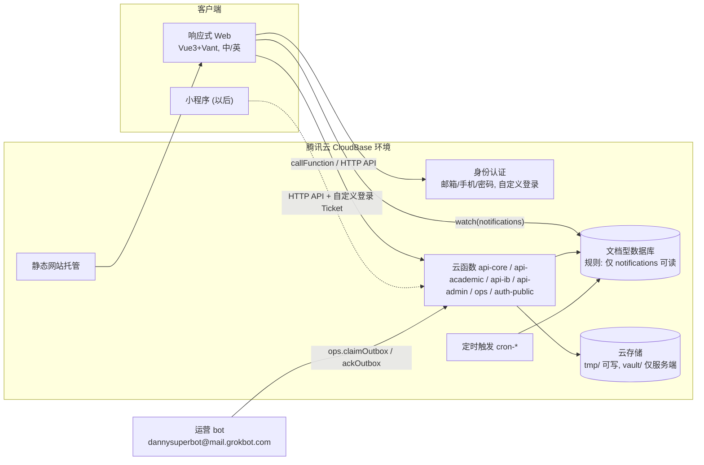

# 家校联络平台（IB MYP + DP）第一期设计文档

需求原文：`../prompt.md`　待确认问题：`../open-questions.md`
状态：设计稿 v0.1（2026-11-09）。设计类问题先用了默认假设（**待 Danny 确认**）；部署所需的账号和环境信息还没有提供。

## 目录
| 文件 | 内容 |
|---|---|
| [assumptions.md](assumptions.md) | 默认假设清单（每一条都待 Danny 确认），以及会卡住部署的事项：CloudBase 账号和环境 ID、服务端凭据、GitHub 仓库、域名和 ICP 备案、短信、运营 bot 代发 |
| [data-model.md](data-model.md) | 全部集合：字段、类型、索引、关系、谁可以读写；ER 图；演示数据规格 |
| [pages-and-flows.md](pages-and-flows.md) | 按角色列出页面和路由（手机优先），以及主要流程的 mermaid 图 |
| [security-rules.md](security-rules.md) | 规则设计思路（客户端默认全拒绝，权限在云函数里按关系校验）、规则草案、权限矩阵、测试用例（含“家长读不到别人孩子任何数据”的证明用例 PX-01–22） |
| [api.md](api.md) | 云函数和 HTTP API：调用封装、错误码、各模块 action、openid 绑定、通知适配器接口、运营 bot 发件接口、定时任务 |

## 架构一览


## 建议的仓库结构
```
home-school-tracker/
  apps/web/                 # Vue3 + Vite + TS + Vant + vue-i18n
  functions/                # 每个云函数一个目录，用 esbuild 打包
    api-core/ api-academic/ api-ib/ api-admin/ ops/ auth-public/ cron-*/
  packages/core/            # 共享代码：authz、repo、zod 校验、notify 适配器、i18n 邮件模板、错误码
  infra/rules/              # 数据库、存储、云函数的安全规则 JSON（纳入版本控制）
  infra/indexes.json        # 索引定义，用部署脚本创建
  scripts/seed-demo.ts      # 演示数据
  templates/*.csv           # 导入模板
  tests/{unit,authz,rules,e2e}/
  cloudbaserc.json          # envId 通过环境变量注入
  docs/                     # 本目录
```

## 第 1 周实施说明（2026-11-09）

任务确认了三件设计稿里还没定下来的事：CloudBase 用共享环境 `english-little-steps-d0a2b84764b`（因此全部加 `hst_` 前缀，见 [naming.md](naming.md)），仓库是公开的，以及这一周没有部署凭据。

因此第 1 周**不部署**。原里程碑里的「在 dev 环境登录」和「ST-01、ST-02 在真实环境通过」改为：规则 JSON 入库，本地规则解释器覆盖 PX-01–04、PX-09、ST-02、ST-03、ST-05；业务权限测试用内存数据库跑通 PX-05–22。真实 CloudBase 上的规则证明留到拿到凭据之后。通知适配器按任务要求提前到本周，不放到第 5 周。

## 第 3 周实施说明

任务发布会立刻写入每个被布置学生的完成记录，所以学生和家长打开列表就能看见，不必等通知。定时发布由 `publishDueTasks` 处理，逾期只改 `isOverdue`，本周不发提醒。文件先放在 `hst_tmp/`，`file.commit` 复制到 `hst_vault/`。没有密钥时用内存存储，接口与以后的 CloudBase 存储适配器相同。

## 第 2 周实施说明

组织和账号在本地内存库里完成：学年到教学班、CSV 检查和执行、邀请码、知情同意拦截。没有 CloudBase 凭据，所以导入不会调用腾讯云 `CreateUser`，只在本地创建登录身份。CSV 直接提交文本，不走 `tmp/` 文件（文件从临时目录入库是第 3 周）。邀请码这一周只由管理员签发。

## 第一期开发里程碑（按周，共 8 周 + 1 周缓冲）
> 第 0 周的阻塞项（`assumptions.md` §2）没有解决之前，开发可以先在本地和 mock 环境进行，但第 1 周结束前**必须拿到 dev 环境的 envId**，否则规则和集成测试没法跑。

| 周 | 目标 | 交付 / 验收 |
|---|---|---|
| **W0**（并行） | Danny 确认默认假设；提供 CloudBase 账号、dev 和 prod 环境、GitHub 仓库；开始域名备案；确认运营 bot 代发方案 | `assumptions.md` 更新为“已确认” |
| **W1** 地基 | 建立 monorepo 和 CI；配置 `cloudbaserc.json`；在 `packages/core` 实现请求封装、错误码、zod 校验、`authz` 框架（action 注册表要求声明 `scope`）、审计日志、限流；部署“全拒绝”规则；登录页（邮箱密码和邮箱验证码）；`auth.resolve` / `me.get`；i18n 框架 | 在 dev 环境能登录；ST-01、ST-02 通过 |
| **W2** 组织与账号 | 管理员维护学年、学期、年级、班级、学科、教学班；CSV 导入（dry-run 和执行，CreateUser 分批）；亲子、任教、导师关系；邀请码；知情同意页和拦截；首次登录改密码 | 能导入演示学校的数据；PX-14–18、SX-03 通过 |
| **W3** 任务与完成跟踪 | `task.*`、`progress.*`、`submission.*`；文件上传（tmp → commit → vault）和短时效下载；定时发布 `cron-publish`；`cron-reminders` 的逾期计算；学生和家长任务页、老师任务页 | 老师发布任务后，学生和家长在 1 分钟内可见（手动测试和 e2e 测试）；PX-05/06/08/09 通过 |
| **W4** IB 评估 | 评估标准种子数据（MYP 八大学科组 A–D，PP/CP）、DP 评估组成；批改页、成绩矩阵；发布流程；`term_summaries` 计算和成长曲线；DP 1–7 分和 IA（复用里程碑组件的数据结构）；老师看板的 Criteria 分布 | MYP 打分发布后，家长能看到分数和评语；TX-03/04 通过 |
| **W5** 反馈与通知 | 对话串、消息、未读数；`notify.emit` 和适配器（`EmailOutboxAdapter`、`WechatSubscribeAdapter` 空实现）；`outbox` 和 `ops.*` 接口；`cron-weekly-digest` 和 `cron-outbox-maintain`；通知中心和实时监听；偏好设置；中英双语邮件模板 | 运营 bot 联调：成绩发布后家长收到邮件（验收标准 3）；PX-03/07/13/20/22、ST-06/07/08 通过 |
| **W6** CAS | 经历、反思、证据、审核；7 项学习成果汇总；CAS 项目；CAS 访谈（里程碑）；协调员看板 | 演示数据中的 CAS 流程可以走通；SX-04、MX-03 通过 |
| **W7** 里程碑组件 | 模板、计划、步骤（EE、PP、CP、DP_IA）；导师分配；RPPF（字数校验、签字锁定）；逾期提醒发给学生和家长；导师和 EE 协调员页面；家长和学生的项目页 | EE 逾期提醒邮件可以发出；MX-01/02、SX-05 通过 |
| **W8** 看板、演示数据、安全审计、部署 | 家长、学生、老师看板完善；`seed-demo.ts`（MYP 和 DP 各 1 个班，每班 5 名学生）；全接口矩阵测试和金丝雀扫描；规则 diff 检查；手机端走查（iOS Safari、微信内置浏览器、Android Chrome）；`cron-retention`；部署到 prod（演示阶段先用默认域名） | `reports/security-audit.md` 全部通过；输出部署地址；验收标准 1–5 逐条打勾 |
| **W9** 缓冲 | 修复 bug；学校老师试用（UAT）；文档定稿；准备小程序接入说明 | — |

## 验收标准与对应设计
| 验收标准（prompt.md） | 对应设计 |
|---|---|
| 老师布置任务后 1 分钟内学生和家长可见；邮件按设置发出 | 发布时同步写入 `task_progress`，前端打开页面就能读到，并且有通知监听；邮件写入 `outbox` 后，由运营 bot ≤ 5 分钟内发出（`pages-and-flows.md` §6.2） |
| 家长无法读取别人孩子的任何数据，有规则测试证明 | `security-rules.md` §7.3 PX-01–22，加上全接口矩阵测试和金丝雀扫描 |
| MYP 按 Criteria 打分后，家长能看到分数和评语并收到邮件 | `assessment.release` 流程（§6.3），PX-22 |
| 主要页面在手机浏览器上可用 | 手机优先布局（Vant 组件）；W8 做手机端走查 |
| 小程序接入只需新增前端 | 业务全部在云函数；`auth.wechat*`；`WechatSubscribeAdapter`；HTTP API 使用统一的请求封装 |
