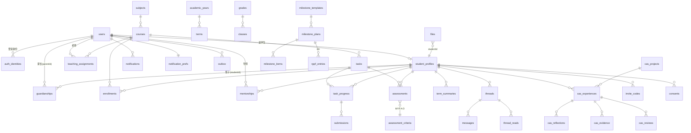

# 数据模型（CloudBase 文档型云数据库）

> 依据 `../prompt.md`，默认假设见 `assumptions.md`。
> 数据库：CloudBase **文档型数据库**（类 MongoDB，传统模式），不使用 PG/MySQL 模式。

## 0. 通用约定

| 约定 | 说明 |
|---|---|
| 主键 | `_id` 为字符串。业务主键加前缀，便于排查：`u_`（用户）、`stu_`、`crs_`、`tsk_` …… 由云函数生成（`nanoid(16)`）|
| 时间 | 统一存 **毫秒时间戳 Number**（UTC）。展示时按 `Asia/Shanghai` 渲染。服务端写入优先用 `db.serverDate()` 再转换，或者统一用 `Date.now()`，二选一，全仓库保持一致（**建议用 `Date.now()`**，因为安全规则里的 `now` 也是毫秒数）|
| 多语言文本 | `I18nText = { zh: string, en?: string }` |
| 公共字段 | 每个业务文档都有：`schoolId`、`createdAt`、`createdBy`（userId）、`updatedAt`、`updatedBy`、`deletedAt?`（软删除）、`schemaVersion` |
| 用户标识 | **业务用户 ID（`users._id`）和认证 ID（CloudBase `uid` / 微信 `openid`）分开存**，映射关系放在 `auth_identities`。所有业务外键都引用 `users._id` |
| 谁可读写 | “客户端”指浏览器或小程序直连数据库（受安全规则约束）；“云函数”指业务 API（用管理员身份访问，**必须在代码里做关系校验**，见 `security-rules.md`）。**除非特别注明，所有集合客户端都是 `read:false, write:false`** |
| 最少采集 | 不采集证件号、住址、出生日期、照片、性别（除非学校另有要求，以后再加） |
| 查询上限 | 服务端单次查询 `limit` 最多 1000 条，超出要分页；看板用 `aggregate` |
| 事务 | `runTransaction` 只支持 `doc()` 单文档操作，最长 10 秒。“领取发件队列”“兑换邀请码”这类场景用**乐观锁（`version` 字段 + 条件 update）**实现 |

角色缩写：**T** 老师，**S** 学生，**P** 家长，**CC** CAS 协调员，**EC** EE/PP 协调员，**SV** 导师（EE 导师、个人项目导师、社区项目导师），**A** 管理员，**OPS** 运营 bot（发件专用账号），**SYS** 定时任务。

---

## 1. 身份与用户

### 1.1 `users`：用户（一个人一条；同一个人可以有多个角色）
| 字段 | 类型 | 说明 |
|---|---|---|
| `_id` | string | `u_xxx` |
| `schoolId` | string | |
| `roles` | string[] | `teacher` `student` `parent` `cas_coordinator` `ee_coordinator` `supervisor` `admin` `ops_mailer`。`supervisor` 只是“可以被分配为导师”的资格，具体带哪些学生看 `mentorships` |
| `displayName` | I18nText | 显示名 |
| `email` | string? | 小写，作为登录账号 |
| `phone` | string? | E.164 格式 `+8613800000000`，只有家长可选填 |
| `locale` | `"zh"`\|`"en"` | 默认 `zh` |
| `status` | enum | `invited` `pending_consent` `active` `suspended` `archived` |
| `mustChangePassword` | bool | 导入的学生和老师首次登录时为 true |
| `lifecycle` | object? | `{ leftAt?, archivedAt?, purgeAfter? }`，见 assumptions A8 |
| `externalRefs` | object? | 预留给 ManageBac/Toddle 的 ID |
| `lastLoginAt` | number? | |
- 索引：`schoolId+email`（唯一，稀疏）、`schoolId+phone`（唯一，稀疏）、`schoolId+roles`、`status`、`lifecycle.purgeAfter`
- 读写：客户端无权。云函数：本人读自己（`me.get`），A 读写全部；T、SV、CC 只能读与自己有关系的学生和家长的 `displayName`（经过 API 投影，不返回 email 和 phone）

### 1.2 `student_profiles`：学生档案（只放必要字段）
| 字段 | 类型 | 说明 |
|---|---|---|
| `_id` | string | `stu_xxx` |
| `userId` | string | → `users._id`（唯一） |
| `studentNo` | string | 学号 |
| `programme` | `"MYP"`\|`"DP"` | |
| `gradeId` | string | → `grades` |
| `homeroomClassId` | string | → `classes`（行政班） |
| `ageBand` | `"under14"`\|`"14plus"` | 不存出生日期 |
| `graduationYear` | number | |
| `consentStatus` | enum | `required` `granted` `revoked`（冗余字段，方便云函数快速拦截） |
- 索引：`userId`（唯一）、`homeroomClassId`、`gradeId`、`schoolId+studentNo`（唯一）
- 读写：客户端无权。云函数：A 读写；S 读自己；P 读已绑定的孩子；T 读自己任教教学班里的学生；SV、CC 读自己负责的学生

### 1.3 `auth_identities`：登录身份映射（预留微信 openid 绑定）
| 字段 | 类型 | 说明 |
|---|---|---|
| `_id` | string | |
| `userId` | string | → `users._id` |
| `provider` | enum | `cloudbase_uid`（Web 端邮箱/手机/密码登录得到的 uid）、`wechat_mp_openid`（小程序 openid）、`wechat_unionid`、`custom`（自定义登录的 customUserId） |
| `appId` | string? | 微信 appId；`cloudbase_uid` 填 envId |
| `key` | string | uid、openid 或 unionid |
| `boundAt` / `unboundAt?` | number | |
- 索引：`provider+appId+key`（**唯一**）、`userId`
- 读写：客户端无权。云函数读写：`auth.resolve`、`auth.wechatBind`；A 可以解绑

### 1.4 `invite_codes`：邀请码（家长自助绑定孩子；也可用于激活账号）
| 字段 | 类型 | 说明 |
|---|---|---|
| `_id` | string | |
| `type` | enum | `guardian_bind`、`account_activate`、`wechat_bind`（Web 端生成的 6 位微信绑定码，5 分钟内有效，此时 `studentId` 为空，`targetUserId` 是生成者本人） |
| `codeHash` | string | **只存哈希**：`sha256(code + pepper)`。邀请码是 8 位，不用易混淆的字符；明文只在生成时显示一次 |
| `studentId` | string | → `student_profiles._id` |
| `relation` | string? | 预设的亲属关系 |
| `createdBy` | string | A 或班主任 |
| `expiresAt` | number | 默认 7 天后 |
| `maxUses` / `usedCount` | number | 默认 1 / 0 |
| `usedBy` / `usedAt` | string? / number? | |
| `status` | enum | `active` `used` `revoked` `expired` |
| `version` | number | 乐观锁 |
- 索引：`codeHash`（唯一）、`studentId+status`、`expiresAt`
- 读写：客户端无权。云函数：A 和班主任创建、撤销；P 通过 `guardian.redeemInvite` 兑换（限流：每个用户每小时最多 5 次尝试）

### 1.5 `consent_policies`、`consents`：同意文本与同意记录
`consent_policies`：`{ _id, version: "2026-11-v1", kind: "privacy"|"guardian_minor", content: I18nText(markdown), effectiveAt, requiresReconsent: bool }`
- 读写：客户端无权；云函数中所有已登录用户可读当前生效的版本，A 可写

`consents`：
| 字段 | 类型 | 说明 |
|---|---|---|
| `_id` | string | |
| `subjectStudentId` | string | 同意针对哪个学生 |
| `grantorUserId` | string | 监护人或学生本人 |
| `grantorRole` | `"guardian"`\|`"student_self"` | |
| `policyVersion` | string | |
| `scopes` | string[] | `basic_processing`（必选）、`email_notifications`、`evidence_upload`（CAS 证据里的照片等） |
| `grantedAt` / `revokedAt?` | number | |
| `ipHash` / `uaHash` | string | 只存哈希，作为证据 |
- 索引：`subjectStudentId+policyVersion`、`grantorUserId`
- 读写：客户端无权。云函数：P 和 S 只能为自己或已绑定的孩子新增或撤回；A 只读。**只追加，不修改**（撤回 = 写入 `revokedAt`，写审计日志）

---

## 2. 学校组织结构

| 集合 | 字段 | 索引 | 读写 |
|---|---|---|---|
| `schools` | `_id, name: I18nText, timezone: "Asia/Shanghai", settings: { digestWeekday: 0, digestHour: 18, mypBoundaries: [...], fileMaxMB: 20 }` | — | A 写；所有已登录用户通过 `me.get` 拿到基础设置 |
| `academic_years` | `_id, schoolId, name: "2026-2027", startDate, endDate, isCurrent: bool, status: "planning"|"active"|"closed"` | `schoolId+isCurrent` | A 写；云函数中所有已登录用户可读 |
| `terms` | `_id, yearId, index: 1|2, name: I18nText, startDate, endDate` | `yearId+index`（唯一） | 同上 |
| `grades` | `_id, schoolId, programme: "MYP"|"DP", level: "MYP1".."MYP5"|"DP1"|"DP2", name: I18nText, order` | `schoolId+programme+level`（唯一） | 同上 |
| `classes`（行政班） | `_id, yearId, gradeId, programme, name: I18nText, homeroomTeacherIds: string[], studentCount` | `yearId+gradeId`、`homeroomTeacherIds` | A 写；T 读自己当班主任的班 |
| `subjects` | `_id, schoolId, programme, groupCode, code, name: I18nText, dpLevel?: "HL"|"SL", criteriaSetId?` | `schoolId+programme+groupCode`、`code`（唯一） | A 写；所有已登录用户可读 |
| `courses`（教学班 = 某学科在某学年的一个上课班；MYP 通常等于“行政班 × 学科”，DP 可以走班） | `_id, yearId, subjectId, programme, gradeId, name: I18nText, homeroomClassId?` | `yearId+subjectId`、`gradeId` | A 写；T、S、P 在有关系时可读 |

`groupCode` 取值：
- MYP 八大学科组：`LL`（语言与文学）`LA`（语言习得）`IS`（个人与社会）`SCI`（科学）`MATH`（数学）`ARTS`（艺术）`PHE`（体育与健康教育）`DES`（设计）
- DP：`G1`–`G6` 以及 `CORE`（TOK/EE/CAS）

### 2.1 关系集合（权限校验的依据）

#### `teaching_assignments`：任教关系
`{ _id, yearId, teacherId, courseId, role: "lead"|"co"|"assistant", startAt, endAt? }`
- 索引：`teacherId+yearId`、`courseId`、`teacherId+courseId`（唯一）
- 读写：A 写；T 读自己的记录

#### `enrollments`：学生选课（学生 ↔ 教学班）
`{ _id, yearId, studentId, courseId, status: "active"|"dropped", joinedAt, leftAt? }`
- 索引：`courseId+status`、`studentId+yearId`、`studentId+courseId`（唯一）
- 读写：A 写；T 读自己任教教学班的选课记录；S 和 P 通过 API 间接读到

#### `guardianships`：亲子关系
`{ _id, parentId, studentId, relation: "mother"|"father"|"guardian"|"other", status: "active"|"revoked", source: "import"|"invite", isPrimary: bool, receivesEmail: bool, createdAt, revokedAt?, revokedBy? }`
- 索引：`parentId+status`、`studentId+status`、`parentId+studentId`（唯一）
- 读写：A 写；P 读自己的记录；家长兑换邀请码时由云函数写入；每次变更都写审计日志

#### `mentorships`：导师、协调员关系
`{ _id, yearId, mentorId, studentId, type: "EE_SUPERVISOR"|"PP_SUPERVISOR"|"CP_SUPERVISOR"|"CAS_ADVISOR"|"IA_TEACHER", refId?: milestonePlanId, status: "active"|"ended" }`
- 索引：`mentorId+type+status`、`studentId+type`、`mentorId+studentId+type`（唯一）
- 读写：A、EC、CC 写（EC 只能写 EE/PP/CP 类型，CC 只能写 `CAS_ADVISOR`）；SV 读自己的记录
- 说明：拥有 `cas_coordinator` 角色的用户可以看本校**全部 DP 学生**的 CAS 记录，这是协调员职责的需要，并且记在审计日志里。如果学校要求协调员也只看所带学生，就改成按 `CAS_ADVISOR` 关系过滤（配置项 `settings.casCoordinatorScope`）

---

## 3. 任务、附件、完成状态

### 3.1 `tasks`：任务
| 字段 | 类型 | 说明 |
|---|---|---|
| `_id` | string | `tsk_xxx` |
| `courseId` | string | 布置给哪个教学班。需要多个班就生成多条任务，用 `groupKey` 关联 |
| `subjectId` / `programme` / `termId` / `yearId` | string | 冗余字段，方便看板聚合 |
| `type` | enum | `homework` `project` `quiz` `formative` `summative` `ia_component` |
| `title` | string | ≤ 120 字 |
| `description` | string | Markdown，≤ 10k 字 |
| `attachmentIds` | string[] | → `files` |
| `dueAt` | number | |
| `publishAt` | number | 定时发布；为空表示马上发布 |
| `status` | enum | `draft` `scheduled` `published` `closed` `archived` |
| `requiresSubmission` | bool | false 表示学生只需“标记完成” |
| `allowLate` | bool | |
| `assessment` | object? | MYP：`{ scheme: "MYP", criteria: ["A","C"] }`；DP：`{ scheme: "DP", scale: 7, iaPlanStepKey?: string }`；不评分时为 null |
| `assigneeMode` | `"all"`\|`"subset"` | subset 时用 `assigneeStudentIds` 指定部分学生 |
| `assigneeStudentIds` | string[]? | |
| `groupKey` | string? | |
| `stats` | object | `{ assigned, notStarted, inProgress, submitted, graded, overdue }`，由云函数增量维护，定时任务纠偏 |
- 索引：`courseId+status+dueAt`、`yearId+subjectId`、`status+publishAt`（定时发布）、`status+dueAt`（逾期扫描）
- 读写：客户端无权。T（该教学班的任课老师）增删改；S 和 P 只能读已发布的任务，并且必须在 `enrollments` 或 `guardianships` 里有对应关系

### 3.2 `task_progress`：每个学生在每个任务上的完成状态（一个学生一个任务一条）
| 字段 | 类型 | 说明 |
|---|---|---|
| `_id` | string | 确定性 ID：`${taskId}_${studentId}`，保证幂等 |
| `taskId` / `courseId` / `studentId` / `termId` / `subjectId` | string | |
| `dueAt` | number | 从任务冗余过来 |
| `status` | enum | `not_started` `in_progress` `submitted` `graded` |
| `isOverdue` | bool | 截止时间过了、但还没提交时为 true（由定时任务和读取时双重计算） |
| `displayStatus` | enum | 显示用的五种状态：`not_started` `in_progress` `submitted` `graded` `overdue` |
| `isLate` | bool | 截止后才提交 |
| `latestSubmissionId` | string? | |
| `submittedAt` / `gradedAt` / `startedAt` | number? | |
| `markedDoneAt` | number? | `requiresSubmission=false` 时学生点“标记完成”的时间 |
- 索引：`studentId+dueAt`（学生时间线）、`taskId+displayStatus`（全班名单）、`courseId+isOverdue`（逾期名单）、`studentId+termId+status`（完成率）
- 读写：客户端无权。任务发布时由 SYS 或云函数批量创建；S 把自己的状态改为 `in_progress` 或 `submitted`；T 改为 `graded`；P 只读

### 3.3 `submissions`：提交版本（可以多次提交）
`{ _id, progressId, taskId, studentId, version: number, text?: string, fileIds: string[], links?: string[], submittedAt, isLate }`
- 索引：`progressId+version`（唯一）、`taskId`、`studentId`
- 读写：S 创建（必须是自己的任务）；T、P 只读

### 3.4 `files`：附件元数据（文件本体在云存储）
| 字段 | 类型 | 说明 |
|---|---|---|
| `_id` | string | `fil_xxx` |
| `cloudFileId` | string | `cloud://env.xxx/vault/...` |
| `stage` | `"tmp"`\|`"vault"` | 客户端上传到 `tmp/`，云函数校验后复制到 `vault/`（见 `security-rules.md` §5） |
| `ownerUserId` | string | 上传人 |
| `refType` | enum | `task` `submission` `cas_evidence` `milestone_item` `message` |
| `refId` | string | |
| `studentId` | string? | 学生相关文件必须填，用于权限校验 |
| `name` / `mime` / `size` / `sha256` | | 大小 ≤ 20MB；MIME 白名单：pdf、docx、pptx、xlsx、jpg、png、heic、mp4（≤ 100MB，可配置） |
- 索引：`refType+refId`、`studentId`、`stage+createdAt`（清理 tmp 文件）
- 读写：客户端无权。下载必须调用 `file.getUrl`，云函数校验关系后签发短时效（600 秒）临时链接

---

## 4. IB 评估标准与打分

### 4.1 `assessment_criteria`：评估标准定义（种子数据，后台可以改）
`{ _id, programme: "MYP", groupCode: "SCI", criterion: "A"|"B"|"C"|"D", title: I18nText, maxLevel: 8, strands: I18nText[], guideVersion: "2014/2021"(以学校所用 IB 指南为准) }`
个人项目和社区项目：`groupCode: "PP"|"CP"`，只有 A–C 三项（规划、技能应用、反思），每项 1–8 级，**种子数据以学校所用 IB 指南版本为准**。

种子数据示例（英文是官方名称，中文是暂译，后台可改）：

| 组 | A | B | C | D |
|---|---|---|---|---|
| SCI | Knowing and understanding | Inquiring and designing | Processing and evaluating | Reflecting on the impacts of science |
| MATH | Knowing and understanding | Investigating patterns | Communicating | Applying mathematics in real-life contexts |
| LL | Analysing | Organizing | Producing text | Using language |
| LA | Listening（或 Comprehending spoken and visual text，按版本） | Reading | Speaking | Writing |
| IS | Knowing and understanding | Investigating | Communicating | Thinking critically |
| ARTS | 以学校所用的艺术指南版本为准 | | | |
| PHE | Knowing and understanding | Planning for performance | Applying and performing | Reflecting and improving performance |
| DES | Inquiring and analysing | Developing ideas | Creating the solution | Evaluating |

- 读写：A 写；所有已登录用户可读（不涉及个人数据）

### 4.2 `dp_components`：DP 学科的评估组成
`{ _id, subjectId, code: "IA"|"P1"|"P2"|"P3"|"EA", name: I18nText, type: "internal"|"external", weightPct: number, maxMark?: number }`
- 读写：A 写；所有已登录用户可读

### 4.3 `assessments`：打分记录（一个学生一个任务一条）
| 字段 | 类型 | 说明 |
|---|---|---|
| `_id` | string | `${taskId}_${studentId}` |
| `taskId` `studentId` `courseId` `subjectId` `termId` `yearId` | string | |
| `scheme` | `"MYP"`\|`"DP"` | |
| `myp` | object? | `{ A?: { level: 0..8, comment?: string }, B?: ..., C?: ..., D?: ... }`。只允许填任务关联了的 Criteria；0 表示没有达到任何描述等级 |
| `dp` | object? | `{ score: 1..7, componentCode?: "IA", rawMark?: number, comment?: string }` |
| `overallComment` | string? | 老师给学生的总评语，同时写入反馈对话串 |
| `status` | enum | `draft`（家长和学生看不到）、`released` |
| `releasedAt` / `gradedBy` | | |
| `history` | array | 修改记录：`[{ at, by, diff }]`，最多保留 20 条，完整记录在审计日志 |
| `version` | number | 乐观锁 |
- 索引：`studentId+subjectId+termId`、`taskId+status`、`courseId+termId`（Criteria 分布）
- 读写：客户端无权。T（该教学班的任课老师）写；S 和 P **只能读 `released` 状态**的记录；发布和修改分数时写审计日志并发出通知

### 4.4 `term_summaries`：学期汇总与成长曲线（预计算）
`{ _id: "${studentId}_${subjectId}_${termId}", studentId, subjectId, termId, scheme, myp?: { A: { bestFit: 0..8, samples: number[] }, ... , total: 0..32, grade: 1..7 }, dp?: { predicted: 1..7, avgTaskScore }, teacherOverride?: { grade, comment, by, at }, computedAt }`
- MYP 等级换算：`total → grade`，边界取 `schools.settings.mypBoundaries`，默认是 IB 通用边界 `[1-5→1, 6-9→2, 10-14→3, 15-18→4, 19-23→5, 24-27→6, 28-32→7]`（**学校可以改**）。`bestFit` 默认取该 Criteria 最近 N 次已发布成绩的中位数，可由老师手动覆盖
- 学年汇总：按 `yearId` 聚合两个学期的数据，查询时计算，不单独存
- 索引：`studentId+termId`、`subjectId+termId`
- 读写：SYS 或云函数在成绩发布时重新计算；T 可以写 `teacherOverride`；S 和 P 只读

### 4.5 IA 进度
DP 内部评估（IA）的进度**复用里程碑组件**：`milestone_plans.programType = "DP_IA"`，每个学科一份。分数存在 `assessments.dp.componentCode = "IA"`。

---

## 5. 反馈对话串与未读

### 5.1 `threads`：对话串
| 字段 | 类型 | 说明 |
|---|---|---|
| `_id` | string | 确定性 ID：`${contextType}_${contextId}_${studentId}` |
| `contextType` | enum | `task` `milestone_plan` `cas_experience` `general`（一般沟通，绑定到学生） |
| `contextId` | string | |
| `studentId` | string | **每个对话串都必须属于某一个学生**，权限按学生计算 |
| `staffUserIds` | string[] | 可以参与的教职工（任课老师、导师），在创建时根据关系生成，关系变化时更新 |
| `lastMessageAt` / `lastMessagePreview` | | 预览 ≤ 60 字 |
| `messageCount` | number | |
- 索引：`studentId+lastMessageAt`、`staffUserIds+lastMessageAt`、`contextType+contextId`
- 读写：客户端无权。云函数按学生关系校验：S 本人、该学生 active 的家长、`staffUserIds` 里的人可以读写

### 5.2 `messages`：消息
`{ _id, threadId, studentId, authorId, authorRole: "teacher"|"parent"|"student"|"supervisor"|"coordinator"|"system", kind: "teacher_comment"|"parent_message"|"student_reflection"|"supervisor_comment"|"system", body: string(≤4000), attachmentIds?: string[], visibility: "all"|"staff_student", createdAt, editedAt?, deletedAt? }`
- `visibility = "staff_student"`：家长看不到。默认 `all`；学生写反思时可以选“仅老师可见”（**默认假设，待 Danny 确认**）
- 索引：`threadId+createdAt`、`studentId+createdAt`
- 读写：同 `threads`；只有作者可以在 15 分钟内编辑或删除自己的消息（软删除）

### 5.3 `thread_reads`：未读标记
`{ _id: "${threadId}_${userId}", threadId, userId, lastReadAt, unreadCount }`
- 新消息写入时，云函数给其他参与者的 `unreadCount` 加 1；用户打开对话串时清零
- 索引：`userId+unreadCount`
- 读写：客户端无权；云函数中只能读写自己的记录

---

## 6. 通知

### 6.1 `notifications`：站内通知（**唯一允许客户端直读的集合**，用于实时监听未读）
| 字段 | 类型 | 说明 |
|---|---|---|
| `_id` | string | |
| `recipientUserId` | string | |
| `recipientAuthUid` | string | 写入时从 `auth_identities` 取 Web 端的 uid，供安全规则使用 |
| `type` | enum | `task_new` `task_due_soon` `task_overdue` `grade_released` `comment_new` `feedback_new` `milestone_due_soon` `milestone_overdue` `cas_reviewed` `cas_due` `system` |
| `studentId` | string? | 和哪个孩子有关（家长端按孩子筛选） |
| `title` / `body` | I18nText | **只写最少的内容**，不放分数和评语正文（例如“数学任务《xx》有新评语”） |
| `link` | string | 前端路由，例如 `/p/tasks/tsk_x?student=stu_y` |
| `refType` / `refId` | string | |
| `readAt` | number? | |
| `digest` | `{ pending: bool, sentAt? }` | 是否已经进入每周汇总 |
| `dedupeKey` | string | 例如 `task_due_soon:tsk_x:stu_y:u_p` |
| `createdAt` | number | |
- 索引：`recipientAuthUid+createdAt`、`recipientUserId+readAt`、`dedupeKey`（唯一）、`digest.pending+recipientUserId`
- 读写：**客户端可读**（规则 `doc.recipientAuthUid == auth.uid`），客户端不能写；标记已读用 `notify.markRead`

### 6.2 `notification_prefs`：通知偏好
`{ _id: userId, locale, channels: { email: { enabled: true, address?, mode: "immediate"|"daily"|"weekly"|"off", types: { task_new: true, grade_released: true, ... } }, wechat_subscribe: { enabled: false, templateIds: {} } }, quietHours?: { start: "22:00", end: "07:00" } }`
- 默认值：家长 `mode = "immediate"`（只发重要事件）并且每周汇总；老师 `mode = "daily"`；学生 `mode = "immediate"`
- “重要事件”默认包括：`grade_released`、`comment_new`、`task_overdue`、`milestone_overdue`；其他事件进入每周汇总（**默认假设，待 Danny 确认**）
- 读写：客户端无权；云函数中本人读写自己的偏好

### 6.3 `outbox`：发件队列（运营 bot 代发）
| 字段 | 类型 | 说明 |
|---|---|---|
| `_id` | string | |
| `channel` | `"email"`\|`"wechat_subscribe"` | |
| `from` | string | 固定为 `dannysuperbot@mail.grokbot.com` |
| `to` | string | 收件地址（投递时从 users 实时取，**不允许调用方随意传入**） |
| `toUserId` | string | |
| `subject` | string | |
| `text` / `html` | string | 已渲染好的内容。**正文只写摘要并附平台链接，不在邮件里写分数和评语全文**（降低误投时的泄露风险，**默认假设，待 Danny 确认**） |
| `templateKey` / `locale` | string | |
| `kind` | `"immediate"`\|`"digest_weekly"`\|`"digest_daily"` | |
| `dedupeKey` | string | 唯一，避免重复发送 |
| `priority` | number | 0 最高 |
| `status` | enum | `pending` `claimed` `sent` `failed` `cancelled` |
| `attempts` | number | 最多 5 次 |
| `scheduledAt` | number | 免打扰时段的邮件会推迟到这个时间 |
| `claimedBy` / `claimedAt` / `leaseUntil` | | 领取后有 10 分钟租约，超时自动回到 `pending` |
| `sentAt` / `providerMessageId` / `lastError` | | |
| `version` | number | 乐观锁 |
- 索引：`status+scheduledAt+priority`、`dedupeKey`（唯一）、`toUserId+createdAt`
- 读写：客户端无权。OPS 只能通过 `ops.claimOutbox` / `ops.ackOutbox` 操作；A 只读（排查问题）；SYS 负责重试和清理（`sent` 状态的记录保留 90 天）

---

## 7. CAS（DP）

### 7.1 `cas_experiences`：CAS 经历
| 字段 | 类型 | 说明 |
|---|---|---|
| `_id` | string | |
| `studentId` | string | |
| `title` / `description` | string | |
| `strands` | `("C"|"A"|"S")[]` | 可以多选 |
| `kind` | `"experience"`\|`"project"` | |
| `casProjectId` | string? | 属于某个 CAS 项目时填写 |
| `startDate` / `endDate?` | number | |
| `plannedOutcomes` | `("LO1".."LO7")[]` | 计划达成的学习成果 |
| `achievedOutcomes` | `("LO1".."LO7")[]` | 协调员审核通过的学习成果 |
| `externalSupervisor` | `{ name, contactNote? }` | **只存名字和备注**，不存校外人员的手机号 |
| `status` | enum | `draft` `submitted` `needs_revision` `approved` `completed` |
| `reviewerId` / `reviewedAt` | | |
- 索引：`studentId+status`、`status+updatedAt`（协调员待审核队列）、`casProjectId`
- 读写：S 创建和编辑自己的经历（`draft` 或 `needs_revision` 状态）；CC 和本学生的 `CAS_ADVISOR` 审核；P 只读

### 7.2 `cas_reflections`：CAS 反思
`{ _id, experienceId, studentId, body?: string, format: "text"|"file"|"link", fileId?, url?, outcomes: LO[], stage?: "investigation"|"preparation"|"action"|"reflection"|"demonstration", createdAt }`
- 索引：`experienceId+createdAt`、`studentId`
- 读写：S 写自己的反思；CC、导师、P 只读

### 7.3 `cas_evidence`：CAS 证据
`{ _id, experienceId, studentId, fileId?, url?, caption, createdAt }`
- 需要 `consents.scopes` 包含 `evidence_upload` 才能上传照片或视频
- 读写：同上

### 7.4 `cas_reviews`：CAS 审核记录
`{ _id, experienceId, studentId, reviewerId, decision: "approve"|"request_changes"|"complete", outcomesConfirmed: LO[], comment, createdAt }`
- 读写：CC 或 `CAS_ADVISOR` 写；S 和 P 只读

### 7.5 `cas_projects`：CAS 项目
`{ _id, title, memberStudentIds: string[], leaderStudentId, strands, startDate, endDate?, durationOk: bool(≥1 个月), stage: "investigation"|"preparation"|"action"|"reflection"|"demonstration", status: "planning"|"active"|"completed", experienceIds: string[] }`
- 读写：成员学生可以编辑；CC 和导师审核；家长只能读**自己孩子是成员**的项目（**API 只返回其他成员的显示名**）

### 7.6 `cas_summaries`：CAS 汇总（预计算）
`{ _id: studentId, outcomes: { LO1: { planned: n, achieved: n, experienceIds: [] }, ..., LO7 }, strandCounts: { C, A, S }, projectStatus, interviewsDone: 0..3, lastUpdated }`
- 7 项学习成果（LO1 了解自己的优势和成长空间；LO2 迎接挑战、发展新技能；LO3 发起并规划 CAS 经历；LO4 投入与坚持；LO5 协作的技能与好处；LO6 参与具有全球意义的议题；LO7 认识并思考选择与行为的道德问题）
- 三次 CAS 访谈用里程碑组件记录：`programType = "CAS"`
- 读写：SYS 或云函数在每次审核后重新计算；S、P、CC、导师只读

---

## 8. 里程碑组件（EE / 个人项目 / 社区项目 / DP IA / CAS 访谈共用）

### 8.1 `milestone_templates`：里程碑模板
| 字段 | 类型 | 说明 |
|---|---|---|
| `_id` | string | |
| `programType` | enum | `EE` `PP` `CP` `DP_IA` `CAS` |
| `yearId` | string | |
| `name` | I18nText | |
| `steps` | array | `[{ key, title: I18nText, kind: "deliverable"|"reflection_session"|"meeting"|"upload"|"approval", dueAt, remindDaysBefore: [7,1], rppfSession?: 1|2|3, requiresSupervisorComment: bool, visibleToGuardian: bool }]` |
EE 默认模板（**以学校所用的 EE 指南版本为准，模板可以配置**）：`topic`（选题）→ `supervisor_assigned`（分配导师）→ `rppf_1`（首次反思会）→ `research_plan`（研究计划）→ `rppf_2`（中期反思会）→ `draft`（初稿）→ `draft_feedback`（初稿反馈）→ `final`（终稿）→ `rppf_3`（终期反思会 / viva voce）
PP/CP 默认模板：`goal`（目标）→ `planning`（规划）→ `process_journal_check_1..n`（过程日志检查）→ `product`（成果）→ `report`（报告）→ `presentation`（展示，可选）
- 读写：A 和 EC 写；所有教职工可读

### 8.2 `milestone_plans`：某个学生（或小组）的计划
`{ _id, programType, templateId, yearId, studentIds: string, supervisorId, subjectId?(EE 学科/IA 学科), title?(选题/研究问题), status: "active"|"completed"|"withdrawn", progress: { done, total, overdue } }`
- 索引：`studentIds+programType`、`supervisorId+programType+status`
- 读写：EC 或 A 创建并分配导师（同时写入 `mentorships`）；S 编辑 `title`；SV 读自己带的计划；P 只读孩子的计划

### 8.3 `milestone_items`：每个步骤的实例
`{ _id: "${planId}_${stepKey}", planId, studentIds, stepKey, kind, title, dueAt, status: "not_started"|"in_progress"|"submitted"|"reviewed"|"waived", isOverdue: bool, fileIds: string[], studentNote?, supervisorComment?, reviewedBy?, reviewedAt?, submittedAt? }`
- 逾期提醒：`cron-reminders` 扫描 `isOverdue=false && dueAt<now && status in (not_started,in_progress)`，发现后把 `isOverdue` 设为 true，并按 `notification_prefs` **同时通知学生和家长**（只通知 `visibleToGuardian=true` 的步骤）
- 索引：`planId`、`studentIds+dueAt`、`status+dueAt`
- 读写：S 提交；SV 写评语和审核；P 只读

### 8.4 `rppf_entries`：EE 反思会记录（RPPF）
`{ _id: "${planId}_${session}", planId, studentId, session: 1|2|3, sessionDate, studentReflection: string, wordCount: number, supervisorComment?: string, supervisorSignedAt?, studentSubmittedAt? }`
- 三次反思合计 ≤ 500 词，由云函数校验（**上限以学校所用的 EE 指南版本为准，可以配置**）
- 读写：S 写自己的反思（导师签字后锁定）；SV 写评语和签字；P 只读（**默认可见，待 Danny 确认**）

---

## 9. 审计、导入、系统

### 9.1 `audit_logs`：审计日志（只追加）
| 字段 | 类型 | 说明 |
|---|---|---|
| `_id` | string | |
| `at` | number | |
| `actorUserId` / `actorRoles` | string / string[] | |
| `action` | string | 见下表 |
| `targetType` / `targetId` | string | |
| `studentId` | string? | 涉及哪个学生 |
| `result` | `"ok"`\|`"denied"`\|`"error"` | |
| `meta` | object | 只存 ID、字段名和前后值的**哈希**，**不存评语正文等内容** |
| `requestId` / `ipHash` / `client` | string | `client`：`web` 或 `mp` |
| `prevHash` | string | 前一条日志的哈希，形成哈希链，方便发现记录被篡改（可选） |
必须写审计日志的 action：`auth.login` `auth.wechat_bind/unbind` `consent.grant/revoke` `guardian.bind/unbind` `invite.create/redeem/revoke` `role.change` `mentorship.change` `import.run` `assessment.release` `assessment.update_after_release` `cas.review` `milestone.review` `file.download`（教职工下载学生文件） `export.student_data` `retention.archive/purge` `authz.denied`（越权尝试）
- 索引：`at`、`studentId+at`、`actorUserId+at`、`action+at`
- 读写：客户端无权。只能由云函数写入（只追加，没有更新和删除接口）；A 通过 `admin.audit.query` 只读；保留 3 年（**默认假设，待 Danny 确认**）

### 9.2 `import_jobs`：导入任务
`{ _id, type: "users"|"guardianships"|"courses"|"enrollments"|"teaching"|"mentorships", fileId, dryRun: bool, status: "validating"|"ready"|"running"|"done"|"failed", total, ok, failed, errors: [{ row, code, message }](≤500), createdBy, createdAt, finishedAt }`
- 读写：A

### 9.3 `cron_locks`：定时任务幂等锁
`{ _id: "${job}-${window}", acquiredAt }`；SYS 读写；7 天后清理

### 9.4 `rate_limits`：限流计数
`{ _id: "${action}:${userId}:${window}", count, expiresAt }`；云函数读写

---

## 10. 关系总览

## 11. 演示数据（交付物 6）
种子脚本 `scripts/seed-demo.ts` 写入以下数据，所有文档带 `demo: true` 标记：
- 学年 2026-2027，两个学期；MYP4 一个班（`MYP4-A`），DP1 一个班（`DP1-A`），每班 5 名学生（使用虚构姓名和 `@demo.school.local` 邮箱）；每个学生 1–2 位家长；4 位老师；1 位 CAS 协调员（同时是 EE 协调员）；2 位 EE 导师
- MYP：科学、数学两个教学班，每科 3 个任务，含 Criteria A–D 的已发布打分，能画出两个学期的成长曲线
- DP：数学 AA SL、物理 HL 的任务，1–7 分，其中物理 IA 处于 `draft` 阶段
- CAS：每个 DP 学生 3–4 段经历（C、A、S 都有），反思和证据样例，审核状态各不相同；一个 CAS 项目由 3 名学生组成
- EE：5 份计划，处于不同阶段；其中 1 份 `rppf_1` 已签字、1 份 `draft` 已逾期（用于演示逾期提醒）
- MYP 社区项目：演示班是 MYP4，所以用社区项目（CP）演示里程碑组件，分成 2 个小组（3 人 + 2 人）。个人项目（PP）通常在 MYP5 进行，这里只提供模板，不提供演示数据
