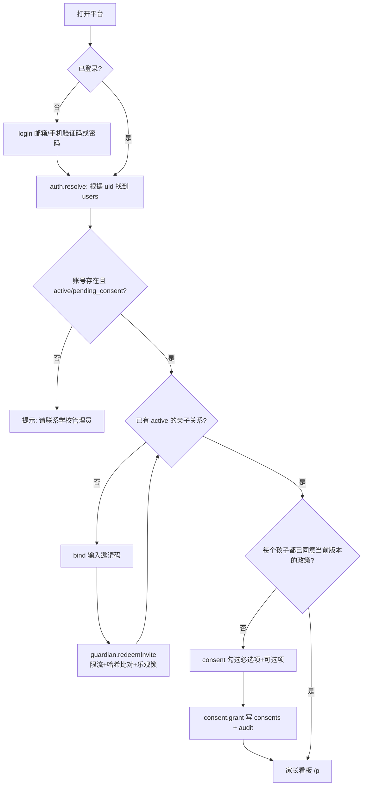
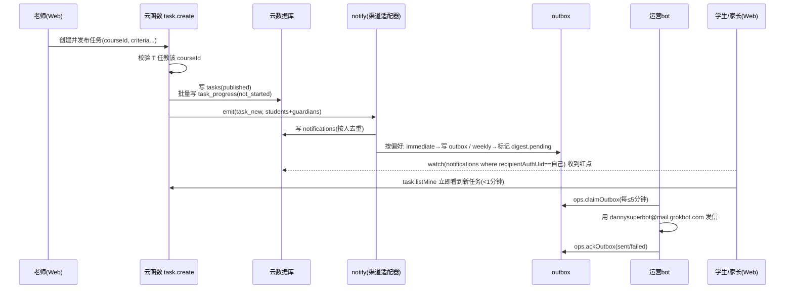
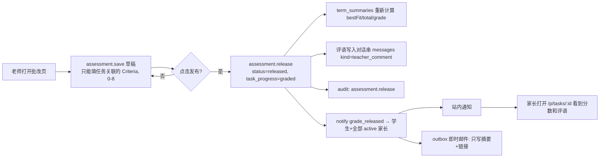
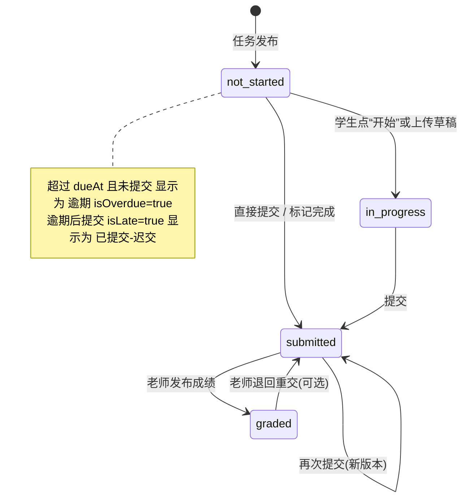
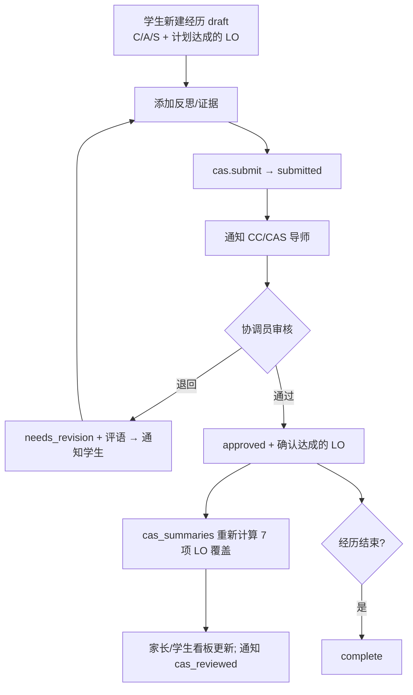
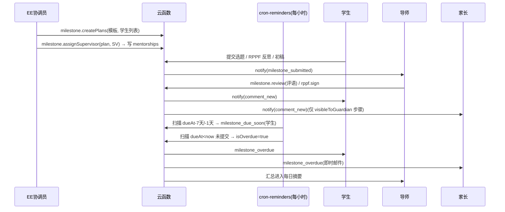
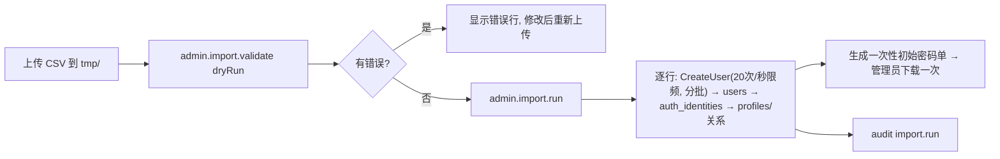
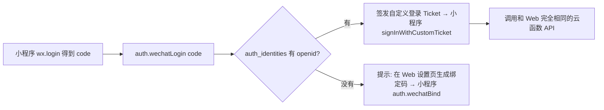

# 页面清单与主要流程

> 手机优先（家长主要用手机）：以 375px 宽度为基准设计，≥ 768px 时切换为双栏布局，≥ 1200px 时老师端显示宽表格和看板。
> 前端建议：Vue 3 + Vite + TypeScript + Vant 4（移动端组件库）+ vue-i18n（默认中文，可切英文）+ Pinia。部署在 CloudBase 静态网站托管，使用 Hash 路由或配置 404 回退到 `index.html`。
> **没有任何公开页面**：除了 `/login`、`/consent`（需要登录）和 `/privacy`（只显示政策文本，不涉及个人数据）以外，所有路由都要求登录、并且已完成知情同意。
> 所有数据都通过云函数 API 获取（见 `api.md`）。唯一的例外是：站内通知未读数通过 `notifications` 集合的 `watch()` 实时监听（失败时退回到每 30 秒轮询一次）。

## 0. 公共页面与全局组件
| 路由 | 页面 | 说明 |
|---|---|---|
| `/login` | 登录 | 页签：邮箱+密码 / 邮箱验证码 / 手机验证码（短信开通后才显示）。“忘记密码”走邮箱验证码重置 |
| `/first-login` | 首次登录改密码 | `mustChangePassword=true` 时强制进入 |
| `/consent` | 知情同意 | 家长：为每个孩子分别勾选（必选项 + 可选项）；14 岁及以上学生：本人确认。显示政策版本号 |
| `/bind` | 绑定孩子 | 输入 8 位邀请码 → 显示孩子的“姓氏 + 名字首字 + 班级”，确认后完成绑定 |
| `/notifications` | 通知中心 | 列表按孩子筛选、全部已读 |
| `/settings` | 设置 | 语言、通知频率（即时 / 每日 / 每周 / 关闭，可按事件类型设置）、免打扰时段、修改密码、已绑定的孩子、退出登录 |
| `/privacy` | 隐私政策 | 静态文本 |
| 全局 | 顶栏：角色切换（同一个人有多个角色时）、孩子切换（家长有多个孩子时）、通知铃铛（红点未读数）；底部 Tab（手机端） | |

## 1. 家长端（`/p/*`，手机优先）
| 路由 | 页面 | 内容 |
|---|---|---|
| `/p` | 看板（首页） | 当前孩子的**本周任务**（按截止日期排序，带状态标签）、**逾期**数量提醒、**近期评语**（最近 5 条）、**IB 进度卡片**：MYP 显示各学科 Criteria 雷达图或最近等级；DP 显示各科最近分数、IA 进度、CAS 7 项学习成果覆盖情况、EE 里程碑进度 |
| `/p/tasks` | 任务列表 | 筛选：本周 / 全部 / 逾期 / 已批改，按学科筛选 |
| `/p/tasks/:taskId` | 任务详情 | 说明、附件（下载使用短时效链接）、孩子的状态和提交时间、**已发布的成绩和评语**、对话串（可以给老师留言） |
| `/p/timeline` | 成长时间线 | 按时间倒序显示任务、成绩、CAS、里程碑事件；顶部显示本学期完成率 |
| `/p/grades` | 成绩 | MYP：每个学科 A–D 的学期汇总和成长曲线（折线图）；DP：各科 1–7 分趋势和 IA 状态 |
| `/p/cas` | CAS（仅 DP） | 经历列表（只读）、学习成果覆盖、CAS 项目、访谈进度 |
| `/p/projects` | EE / 个人项目 / 社区项目 | 里程碑进度条、截止日期、导师评语（只显示 `visibleToGuardian` 的步骤） |
| `/p/messages` | 消息 | 和孩子相关的所有对话串，显示未读标记 |

## 2. 学生端（`/s/*`）
| 路由 | 页面 | 内容 |
|---|---|---|
| `/s` | 首页 | 今天和本周截止的任务、逾期任务、新评语、里程碑提醒 |
| `/s/tasks`、`/s/tasks/:id` | 任务 | 详情页可以“开始”（状态变为进行中）、上传或填写并提交（可以多个版本）、或者“标记完成”；写反思（可以选“仅老师可见”）；对话串 |
| `/s/grades` | 我的成绩 | 和家长看到的一样 |
| `/s/cas`、`/s/cas/new`、`/s/cas/:id` | CAS | 新建或编辑经历（选择 C/A/S、计划达成的学习成果）、添加反思和证据、提交审核、查看审核意见 |
| `/s/cas/project/:id` | CAS 项目 | 成员、阶段、关联的经历 |
| `/s/projects/:planId` | EE / 个人项目 / 社区项目 | 编辑选题、提交各步骤、填写 RPPF 反思（显示字数）、导师评语 |

## 3. 老师端（`/t/*`，同时适配桌面）
| 路由 | 页面 | 内容 |
|---|---|---|
| `/t` | 看板 | 选择教学班后显示：**全班完成率**、**逾期名单**（可以一键提醒）、**各 Criteria 等级分布**（柱状图）、待批改数量、未读家长留言 |
| `/t/courses/:courseId` | 教学班 | 学生名单（只显示名字和学号），进入某个学生后看到该生的时间线 |
| `/t/tasks/new`、`/t/tasks/:id/edit` | 布置任务 | 标题、学科（由教学班带出）、类型、截止时间、定时发布、说明（Markdown）、附件、**关联的 IB 评估标准**（MYP 勾选 A–D；DP 选择 1–7 分制，可以选择关联 IA）、需要提交还是只需标记完成、指定部分学生 |
| `/t/tasks/:id` | 任务详情与完成情况 | 五种状态的统计、学生列表（可以筛选）、点进学生后批改 |
| `/t/tasks/:id/grade/:studentId` | 批改 | 查看提交的各个版本 → MYP 每个 Criteria 选择 0–8 级并写评语；DP 填 1–7 分；总评语 → “保存草稿”或“发布”（发布后家长和学生可见并收到通知） |
| `/t/grade-matrix/:courseId` | 成绩矩阵（桌面） | 学生 × 任务 × Criteria 的表格，批量发布 |
| `/t/students/:studentId` | 学生画像 | 只限任教关系内的学生：完成率、各 Criteria 曲线、该生所有对话串 |
| `/t/messages` | 消息 | 自己教学班里所有对话串，未读排在前面 |
| `/t/ia/:courseId` | IA 进度（DP） | 全班 IA 里程碑表格 |

## 4. CAS 协调员 / EE 导师 / 项目导师（`/c/*`、`/m/*`）
| 路由 | 页面 | 内容 |
|---|---|---|
| `/c` | CAS 看板 | 待审核队列、学习成果覆盖热力图（学生 × LO1–7）、CAS 项目状态、访谈完成情况、长期没有活动的学生 |
| `/c/review/:experienceId` | 审核 | 经历、反思和证据 → 通过 / 退回修改（附评语）/ 确认已达成的学习成果 |
| `/c/students/:studentId` | 学生 CAS 档案 | |
| `/m` | 我带的学生 | 按 EE / 个人项目 / 社区项目 / CAS 导师分组；每人显示进度和逾期标记 |
| `/m/plans/:planId` | 里程碑详情 | 审核步骤、写评语、RPPF 会议记录和签字、调整截止日期（需要 EC 权限） |
| `/m/ee-admin` | EE 管理（EC） | 分配导师、导入或修改模板、整体进度 |

## 5. 管理员端（`/a/*`，桌面）
| 路由 | 页面 |
|---|---|
| `/a/years` | 学年和学期 |
| `/a/structure` | 年级、行政班、学科（MYP 八大学科组 / DP 六组 + 核心）、教学班 |
| `/a/criteria` | 评估标准、MYP 等级边界、DP 评估组成 |
| `/a/import` | CSV 导入向导：选择类型 → 上传 → **先检查（dry-run）** → 显示错误行 → 确认执行 → 生成账号；可以下载初始密码单（只能下载一次，链接 10 分钟内有效） |
| `/a/users`、`/a/users/:id` | 用户、角色、状态；重置密码；封禁账号 |
| `/a/relations` | 亲子关系、任教关系、导师关系；生成邀请码 |
| `/a/consents` | 同意情况总览（未同意名单），政策版本 |
| `/a/notifications` | 发件队列监控（待发 / 失败），通知模板 |
| `/a/audit` | 审计日志查询 |
| `/a/retention` | 毕业生归档和删除计划 |

## 6. 主要流程

### 6.1 首次登录 → 知情同意 → 绑定孩子（家长）

### 6.2 老师布置任务 → 学生/家长 1 分钟内可见 → 邮件

- 定时发布：`cron-publish` 每分钟扫描 `status=scheduled && publishAt<=now`，执行和上图相同的步骤。

### 6.3 MYP 按 Criteria 打分 → 家长看到分数和评语 → 收到邮件

发布后再修改：写 `assessment.update_after_release` 审计日志，并重新通知（文案为“成绩已更新”）。

### 6.4 学生提交 / 标记完成 与 状态机

### 6.5 CAS 登记与审核

### 6.6 EE 里程碑与逾期提醒（个人项目、社区项目、IA 共用同一组件）

### 6.7 每周汇总
`cron-weekly-digest` 每周日 18:00（北京时间）运行：对每个 `mode ∈ {weekly, immediate}` 的家长，汇总 `digest.pending` 的通知，加上孩子下周到期的任务和本周的完成率 → 每个家长生成**一封**邮件写入 `outbox`（`dedupeKey = digest:${userId}:${isoWeek}`）→ 把这些通知的 `digest.pending` 置为 false。

### 6.8 CSV 导入（管理员）

### 6.9 小程序将来如何接入（只预留，不开发）

